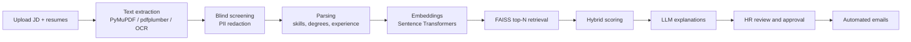

# OptiRAG: Optimizing Resume Screening Using RAG

OptiRAG is an HR-facing resume screening system. HR uploads a job description and a batch of resumes, and OptiRAG ranks the candidates using semantic search, explains each ranking in plain language, and then emails shortlisted and rejected candidates once HR approves the list.

It combines a **fine-tuned Sentence Transformers embedding model**, **FAISS** vector retrieval, **spaCy** skill and experience extraction, and an **LLM (Google Gemini)** for explanations and an HR assistant chatbot. The backend is **FastAPI**, the frontend is **Streamlit**.

## Features

- **Resume and JD ingestion**: upload PDF/DOCX resumes and PDF/DOCX/TXT job descriptions. Text is extracted with PyMuPDF, pdfplumber and pdfminer, with OCR (Tesseract) as a fallback for scanned files.
- **Blind screening**: names, emails, phone numbers, links, organizations and locations are redacted before scoring, to reduce bias in the ranking.
- **Structured parsing**: spaCy and a skills dictionary extract skills, degrees and years of experience from resumes and job descriptions.
- **Semantic ranking with FAISS**: resumes and the JD are embedded, the top-N candidates are retrieved by cosine similarity, and each one gets a hybrid score:

  `score = 0.7 × semantic similarity + 0.2 × skill overlap + 0.1 × experience match`

- **Explainable results**: an LLM generates a profile summary, highlights matching parts of the resume, and gives a reason for candidates who were not selected.
- **Reports**: download the ranked results as CSV.
- **Automated emails**: HR confirms the shortlist, then OptiRAG sends "shortlisted" and "not shortlisted" emails through Gmail SMTP and keeps a send log.
- **HR chatbot**: ask questions about the screening process and results, answered with Gemini.
- **Continuous learning hook**: an endpoint to start fine-tuning from a screening session.
- **HR accounts**: sign-up and login, with users stored in MongoDB and passwords hashed.

## How it works



## Tech stack

| Area | Tools |
| --- | --- |
| Backend | Python, FastAPI, Uvicorn |
| Frontend | Streamlit |
| Retrieval | Sentence Transformers, FAISS (CPU) |
| NLP | spaCy (`en_core_web_sm`, `en_core_web_md`), scikit-learn, RapidFuzz |
| Document parsing | PyMuPDF, pdfplumber, pdfminer.six, python-docx, Tesseract OCR |
| LLM | Google Gemini API |
| Database | MongoDB |
| Email | Gmail SMTP |

## Project structure

```
.
├── backend/
│   ├── main.py              # FastAPI app and router registration
│   ├── core/                # config, database, logger, session store
│   ├── pipeline/            # extraction, blind screening, parsing, embeddings, scoring
│   ├── routers/             # auth, upload, matching, reports, emailer, chat, training
│   ├── services/            # chatbot and pipeline orchestration
│   ├── utils/               # Gemini client, file handling, password hashing
│   ├── assets/              # skills dictionary
│   └── models/              # place the fine-tuned model here (not included)
├── frontend/
│   ├── app.py               # login / sign-up page
│   ├── pages/               # dashboard, resume screening, automated email, chatbot, profile
│   ├── components/          # API client, navbar, auth helpers
│   └── requirements.txt
└── requirements.txt
```

## Getting started

### Prerequisites

- Python 3.10 or newer
- A running MongoDB instance 
- A Google Gemini API key
- Tesseract OCR installed on your system (only needed for scanned resumes)
- A Gmail account with an app password

### 1. Clone and install

```bash
git clone https://github.com/26Shama/OptiRAG.git
cd OptiRAG

python -m venv .venv
source .venv/bin/activate        # Windows: .venv\Scripts\activate

pip install -r frontend/requirements.txt
python -m spacy download en_core_web_sm
python -m spacy download en_core_web_md
```

### 2. Configure environment variables

```bash
cp backend/.env.example backend/.env
```

Then edit `backend/.env`:

| Variable | Description |
| --- | --- |
| `MONGO_URI` | MongoDB connection string |
| `MONGO_DB_NAME` | Database name |
| `GEMINI_API_KEY` | Gemini API key for explanations and the chatbot |
| `JWT_SECRET_KEY` | Reserved. Token auth is currently disabled in the code. |

Never commit `backend/.env`. It is already listed in `.gitignore`.

### 3. Add the embedding model

The fine-tuned model is not included in this repository because of its size. The backend loads it from:

```
backend/models/fine_tuned_model/final_model
```

Place your fine-tuned Sentence Transformers model there. To try the app without it, you can point `MODEL_PATH` in `backend/pipeline/model_init.py` to a public Sentence Transformers model instead. Ranking quality will differ from the fine-tuned model.

### 4. Run the app

Start the backend from the repository root:

```bash
uvicorn backend.main:app --reload --port 8000
```

In a second terminal, start the frontend:

```bash
streamlit run frontend/app.py
```

## Usage

1. Sign up and log in as an HR user.
2. Open **Resume Screening**, upload a job description and a batch of resumes, choose how many top candidates you want, and run the screening.
3. Review the ranked list and explanations, and download the CSV report.
4. Confirm the shortlist, then open **Automated Email**, enter your Gmail address and app password, and send the emails.
5. Use **Any Queries** to ask the HR assistant questions.

## API overview

| Endpoint | Purpose |
| --- | --- |
| `POST /auth/signup`, `/auth/login`, `/auth/logout` | HR accounts |
| `/resumes/*`, `/jd/*` | Upload resumes and job descriptions |
| `POST /matching/run` | Run screening and ranking for a session |
| `GET /matching/explanation/{candidate_id}` | Explanation for one candidate |
| `GET /reports/download-csv/{session_id}` | Download results as CSV |
| `POST /train/fine-tune-session` | Start fine-tuning from a session |
| `POST /chat/query` | HR assistant chatbot |
| `GET /health/ping` | Health check |

## Privacy notes

- Resumes are redacted (names, emails, phone numbers, links, organizations, locations) before they are scored.
- The Gmail app password is entered in the UI at send time and is not stored in the code.
- Email logs and candidate mapping files are generated at runtime and are excluded from version control. Do not commit real candidate data.


